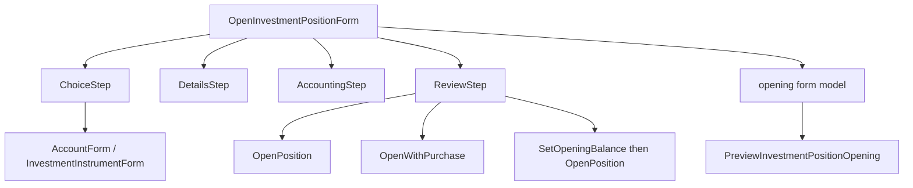

# Fluxo progressivo de cadastro de investimentos - Design

**Spec**: `.specs/features/investment-registration-flow/spec.md`
**Status**: Approved

## Architecture Overview

O componente atual vira um orquestrador de estado e submissão. Regras puras ficam no model; componentes de etapa recebem `control`, dados derivados e callbacks. O formulário RHF permanece montado durante criação rápida e navegação, preservando o rascunho.



## Code Reuse Analysis

| Component | Location | How to Use |
| --- | --- | --- |
| Controlled fields | `apps/tauri/src/components/forms` | Campos RHF com erro e descrição acessíveis. |
| AccountForm | `apps/tauri/src/features/accounts/components/account-form.tsx` | Cadastro rápido de carteira sem novo domínio. |
| InvestmentInstrumentForm | `apps/tauri/src/features/investments/forms/investment-instrument-form.tsx` | Cadastro rápido e retorno do DTO criado. |
| useInvestmentSubmission | `apps/tauri/src/features/investments/hooks/use-investment-submission.ts` | requestId, retry, recibo idempotente e invalidação. |
| previewOpening | `packages/application/src/investments/queries/preview-investment-position-opening.ts` | Prévia contábil autoritativa. |
| Collapsible/Card/Alert/Button | `packages/ui/src/components` | Revelação avançada, hierarquia e feedback. |

## Components

### Opening form model

- **Purpose**: Schema, classificação de tipos, termos, validação por etapa e montagem da prévia.
- **Location**: `apps/tauri/src/features/investments/forms/open-investment-position-form-model.ts`
- **Reuses**: tipos de comandos de `@workspace/application`.

### InvestmentRegistrationSteps

- **Purpose**: Componentes de apresentação para escolha, dados e origem contábil.
- **Location**: `apps/tauri/src/features/investments/forms/investment-registration-steps.tsx`
- **Interfaces**: props tipadas com `Control<OpeningFormValues>`, dados selecionados e callbacks.
- **Reuses**: ControlledInput, ControlledSelect, ControlledToggleGroup, Collapsible e Button.

### InvestmentRegistrationReview

- **Purpose**: Resumo legível, prévia contábil, avisos e confirmação de saldo inicial.
- **Location**: `apps/tauri/src/features/investments/forms/investment-registration-review.tsx`
- **Reuses**: Card, Alert, formatMinorAmount e o read model da prévia.

### OpenInvestmentPositionForm

- **Purpose**: Orquestrar etapas, criação rápida, prévia, comandos e recuperação.
- **Location**: `apps/tauri/src/features/investments/forms/open-investment-position-form.tsx`
- **Reuses**: todos os serviços e hooks existentes, sem alterações de domínio.

## Data Models

```typescript
type RegistrationStep = "CHOICE" | "POSITION" | "ACCOUNTING" | "REVIEW"

type OpeningFormValues = {
  mode: "OWNED" | "BUY"
  origin: "INTERNAL_CASH" | "EXTERNAL_ACCOUNT" | "NOT_RECORDED"
  investmentAccountId: string
  instrumentId: string
  quantityMode: "AMOUNT" | "UNITS"
  quantity: string
  costDisplay: string
  initialCashDisplay: string
  occurredOn: string
  label: string
  description: string
  // termos opcionais existentes
}
```

`valuationDisplay` deixa de existir no form model. Nenhum valor de avaliação entra na prévia ou nos comandos de abertura.

## Error Handling Strategy

| Error Scenario | Handling | User Impact |
| --- | --- | --- |
| Campo contextual inválido | `trigger`/erro RHF e foco no resumo | Permanece na etapa e corrige no local. |
| Prévia falha | Alert com retry; final desabilitado | Nenhum comando é enviado sem revisão. |
| Saldo inicial confirma e alocação falha | `confirmedBalance=true` preservado | Retry executa somente a alocação. |
| Mutação falha sem recibo | Mensagem inline + toast | Rascunho e requestId permanecem. |
| Catálogo rápido falha/cancela | Subform mantém seu erro ou volta | Rascunho principal permanece montado. |

## Risks & Concerns

| Concern | Location (file:line) | Impact | Mitigation |
| --- | --- | --- | --- |
| Formulário atual concentra 887 linhas | `open-investment-position-form.tsx:1` | Mudanças frágeis e baixa reutilização | Extrair model, etapas e revisão. |
| `valuationDisplay` é coletado e nunca persistido | `open-investment-position-form.tsx:662` | Usuário acredita ter salvo avaliação | Remover o campo e explicar ação posterior. |
| Saldo inicial e alocação são dois comandos | `open-investment-position-form.tsx:440` | Falha parcial pode repetir patrimônio | Preservar `confirmedBalance` e exigir confirmação dedicada. |
| Resumo de erro atual não recebe foco | `open-investment-position-form.tsx:850` | Teclado/leitor pode não localizar falha | Alert focável e foco apenas após validação bloqueante. |

## Tech Decisions

| Decision | Choice | Rationale |
| --- | --- | --- |
| Estado do wizard | Estado local + um único RHF | Mantém campos e validação sem duplicar fontes de verdade. |
| Busca de instrumento | Lista filtrada localmente | Catálogo já está carregado e não exige novo serviço. |
| Avaliação inicial | Removida do fluxo | Não há persistência atômica aprovada com abertura. |
| Confirmação de patrimônio ausente | Ação explícita na revisão | Torna o lançamento patrimonial compreensível e auditável. |

